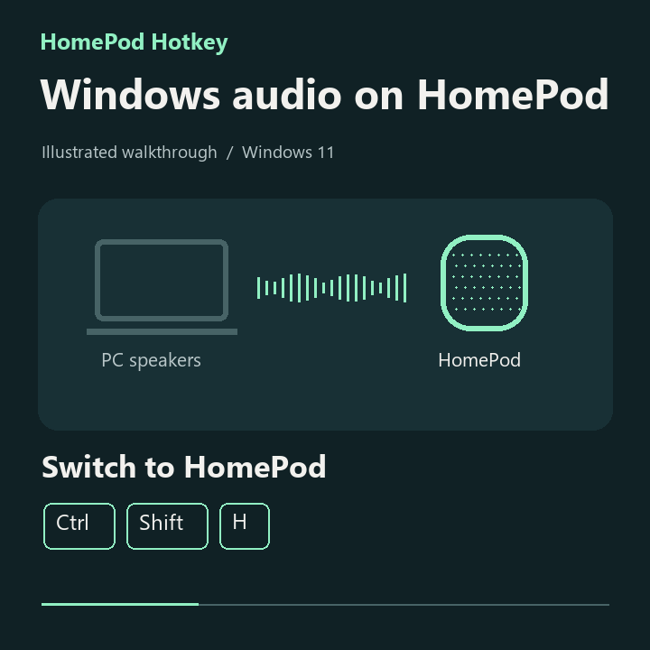
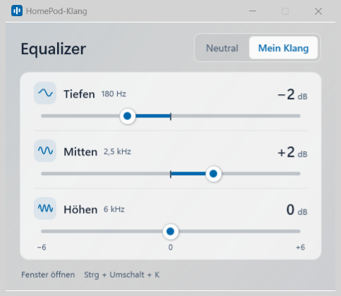

# HomePod Hotkey

Stream Windows 11 audio to a HomePod. Press **Ctrl + Shift + H** once and **allow a few seconds for the PC to find and connect to the HomePod**. Move the usual Windows volume slider to change the HomePod volume. Press the shortcut again to restore your PC speakers and their previous volume.

[Download HomePod Hotkey for Windows 11](https://github.com/ekrasniq/homepod-hotkey/releases/tag/v0.3.0) · [Watch the 20-second illustrated walkthrough](https://github.com/ekrasniq/homepod-hotkey/releases/download/v0.1.0/homepod-hotkey-demo.mp4)

## Set up

1. Connect the Windows 11 x64 PC and HomePod to the same local network with AirPlay access. Setup needs internet access on the PC.
2. Download **homepod-hotkey-0.3.0-win11-x64.zip** and extract it to a folder you intend to keep. To upgrade, stop streaming, extract over the previous installation and run setup again.
3. Double-click **Setup.cmd**. It detects standard x64 CPython 3.12, 3.13, 3.14 or 3.15. If it finds no compatible interpreter, it downloads and verifies an official Python Software Foundation runtime and installs it inside the app folder. Setup installs the audio packages, checks the sender and equalizer, then creates the Start menu shortcut. The terminal stays open. Press a key after the success message to close it. On failure you can retry in the same window.
4. Play something at a comfortable volume. Press **Ctrl + Shift + H** once. Allow a few seconds for the connection, then try the Windows volume slider. A second press switches back to your PC. The Start menu entry does the same thing.

**Multiple HomePods?** Open a terminal in the extracted folder and run `.\Setup.cmd --device "Kitchen"`, replacing Kitchen with your HomePod name. Re-run setup after moving the folder. If another app uses the shortcut, open **HomePod Hotkey** from Start.

The compiled app ships separately for each supported CPython minor version. A PC with only a newer, 32-bit or free-threaded interpreter uses the app-local Python 3.14.8 fallback. To explicitly select this runtime, run `.\Setup.cmd --private-python`. Setup stores dependencies under `.homepod` and requires no administrator privileges.

## Adjust the HomePod sound

The equalizer opens when you connect. All three sliders work during playback and affect only the audio sent to the HomePod. For a first listen to the strings in Hans Zimmer’s *Time*, try **Tiefen** (bass) at **−2 dB**, **Mitten** (mids) at **+2 dB** and **Höhen** (treble) at **0 dB**. Switch between **Neutral** and **Mein Klang** to compare. The sender remembers your settings for the next connection.

Close the window with **X** to keep listening. Press **Ctrl + Shift + K** to show it again. If another app already uses that shortcut, the window shows the available alternative.

## Tested on Windows 11

The 0.1.0 preview played system audio on a first-generation HomePod with the PC speakers muted, responded to the Windows slider and switched back using the shortcut. A microphone measurement during continuous playback on that setup put the delay from Windows audio capture to sound at **about 0.35 seconds**. Audio was sent as 16-bit stereo at 44.1 kHz. The 0.2.0 equalizer was tested with synthetic audio on Windows 11.

HomePod mini, stereo pairs and other Windows audio drivers still need testing. Some drivers may also silence loopback capture when the local output is muted.

## Troubleshooting

- To see connection messages, run `.\HomePod.cmd` from a terminal. Stop with **Ctrl + C**. If the HomePod requires an AirPlay password, use this console command so you can enter it.
- Run `.\HomePod.cmd --test-tone` to send six short tones directly. If they play but desktop audio is silent, check which Windows playback device the app uses. Share the result in [Issues](https://github.com/ekrasniq/homepod-hotkey/issues).
- To uninstall, stop streaming, remove **HomePod Hotkey** from your Start menu's Programs folder and delete the extracted folder including its private Python environment.

## License and dependencies

The app is free to use under the [use license](LICENSE.txt). The ZIP contains the compiled sender. Setup downloads packages from PyPI, including [pyatv](https://github.com/postlund/pyatv), [PyAudioWPatch](https://github.com/s0d3s/PyAudioWPatch), [pycaw](https://github.com/AndreMiras/pycaw), [NumPy](https://numpy.org/) and [pythonnet](https://pypi.org/project/pythonnet/). The Python 3.15 build uses the Windows DLL from [libsamplerate](https://github.com/libsndfile/libsamplerate/releases/tag/0.2.2). Its BSD license is in `app/native/LICENSE.txt`. The app-local interpreter comes from the [Python Software Foundation's NuGet package](https://www.nuget.org/packages/python/3.14.8). HomePod Hotkey is an independent project.
